<p align="center">
  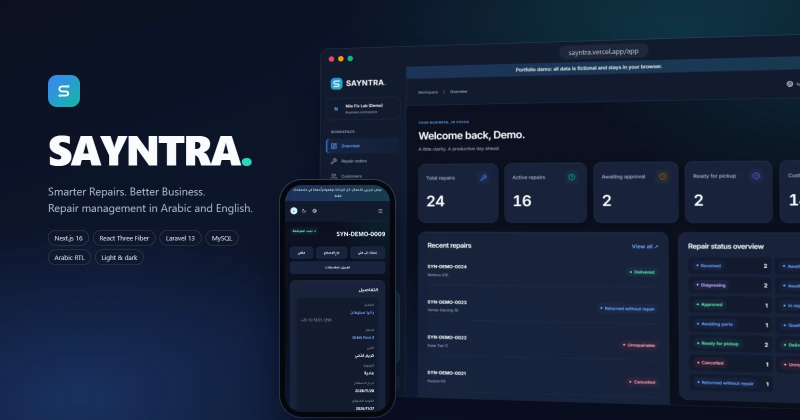
</p>

<h1 align="center">SAYNTRA</h1>
<p align="center"><b>A smarter way to manage repairs</b><br><i>Smarter Repairs. Better Business. · صاينترا</i></p>

<p align="center">
  <a href="https://sayntra.vercel.app"><b>Live website</b></a> &nbsp;·&nbsp;
  <a href="https://sayntra.vercel.app/demo"><b>Interactive demo</b></a> &nbsp;·&nbsp;
  <a href="docs/CASE_STUDY.md"><b>Case study</b></a> &nbsp;·&nbsp;
  <a href="docs/media/preview.mp4"><b>Walkthrough (MP4)</b></a>
</p>

<p align="center">
  
  
  
  
  
</p>

---

SAYNTRA is a bilingual repair-management platform for phone and electronics repair centers. It brings customers, devices, repair intake, technician assignment, diagnosis and a guarded status workflow into one workspace, in Arabic and English, in light and dark. The public site opens with a procedurally modelled 3D smartphone that tells the story of one repair, from intake to pickup.

The repository holds two runnable shapes of the same frontend:

- **The full application:** Next.js talking to a Laravel 13 API with MySQL, Sanctum cookie sessions and organization-scoped multi-tenancy.
- **The public portfolio demo** at [sayntra.vercel.app](https://sayntra.vercel.app): the same interface built with `NEXT_PUBLIC_DEMO_MODE=true`. It replaces the API with an in-browser backend seeded with fictional data. No account, no server and no database are involved.

> SAYNTRA is an independent portfolio project and a development checkpoint, not a commercial SaaS in production. Every name, phone number and repair in the demo is fictional, and demo changes stay in the visitor's browser.

<p align="center">
  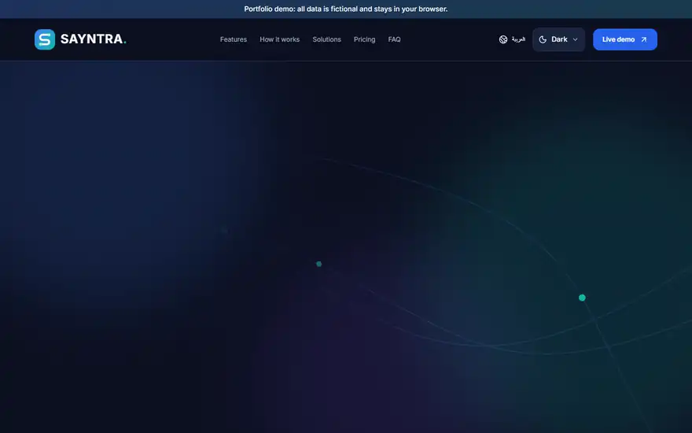
  <br><sub>Real capture of the live deployment (8 fps preview, 46 s; full-quality <a href="docs/media/preview.mp4">MP4</a>).</sub>
</p>

## The problem

Small repair centers often run on paper tickets, chat messages and spreadsheets. A device comes in, a technician is told verbally, the customer calls to ask for news, and nobody can say quickly who has which device or why it is waiting. In Egypt and the wider Arab region, the tools that exist are usually English-only or treat Arabic as a translated afterthought.

SAYNTRA explores what a calm, structured workspace for that work looks like: one record per repair, a clear owner, an enforced sequence of statuses and a history of who changed what, designed for Arabic and English from the start.

## What it does

| | |
|---|---|
| **Repair orders** | Intake links a customer and a device and generates a unique reference. Technicians are assigned and reassigned, diagnosis findings are recorded, and every status change goes through an allowed-transition map with stale-state protection. |
| **Status workflow** | Received → Awaiting diagnosis → Diagnosing → … → Quality check → Ready for pickup, with cancellation and *unrepairable* exits. Each transition is written to the repair timeline with the actor and time. |
| **Customers and devices** | Searchable records with full repair history. Phone numbers are normalized and unique per organization, and devices keep their history across repeat visits. |
| **Team and roles** | Owner, manager, receptionist and technician roles with fixed permission sets. Invitations use hashed, expiring, single-use tokens. The last active owner cannot be removed. Technicians only see repairs assigned to them, without customer contact data. |
| **Dashboard** | Live counts (total, active, awaiting approval, ready for pickup, customers), recent repairs and a status overview, filtered by role. |
| **Bilingual by design** | Complete Arabic with RTL layout through logical CSS properties, Tajawal for Arabic and Inter for English, translated status names and dates. Language and theme persist across visits. |
| **Immersive landing** | A procedural 3D smartphone in the hero, a scroll-driven *Follow one repair* story (intake, diagnosis x-ray, exploded view, connected operations, reassembly, pickup) and a shader-based Living Network background, with reduced-motion and no-WebGL fallbacks. |

## Gallery

<table>
<tr><td colspan="2">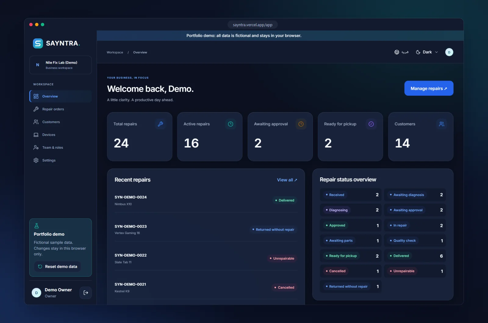<br><sub><b>Dashboard</b>: live repair counts, recent repairs and the status overview (dark).</sub></td></tr>
<tr>
<td width="50%">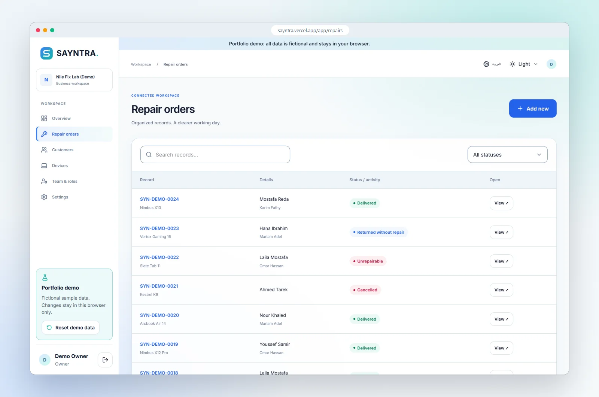<br><sub><b>Repair orders</b>: search and status filters across every order.</sub></td>
<td width="50%">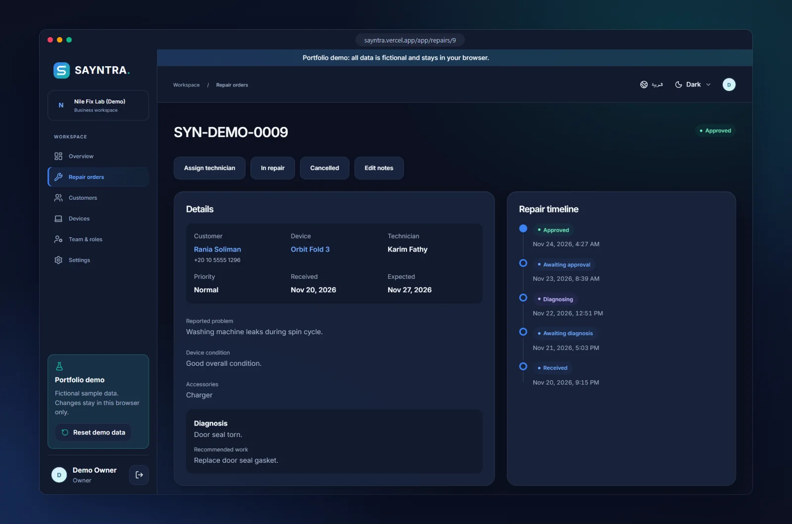<br><sub><b>Repair details</b>: allowed next steps, assignment, diagnosis and the timeline.</sub></td>
</tr>
<tr>
<td>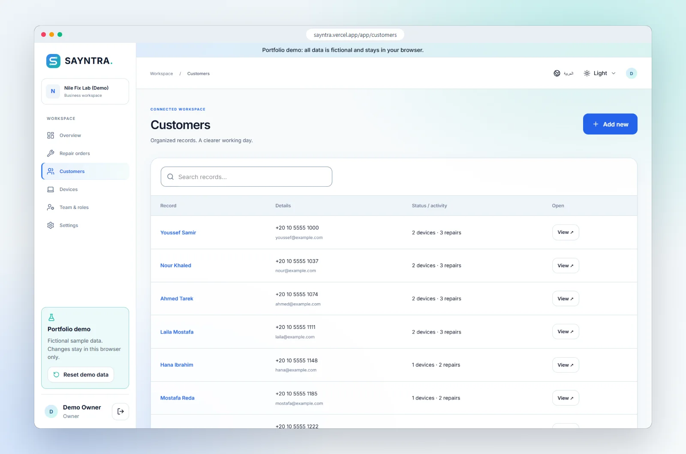<br><sub><b>Customers</b>: normalized phones and repair counts.</sub></td>
<td>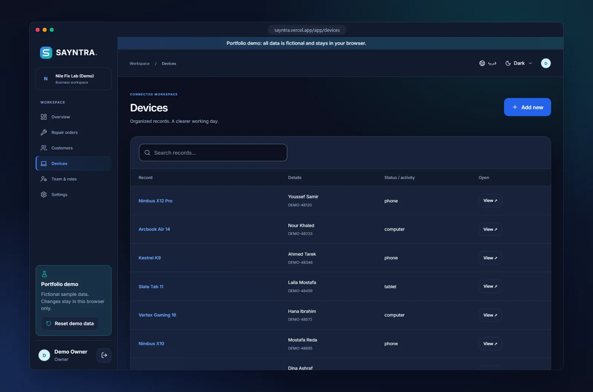<br><sub><b>Devices</b>: every device with its owner and history.</sub></td>
</tr>
<tr>
<td>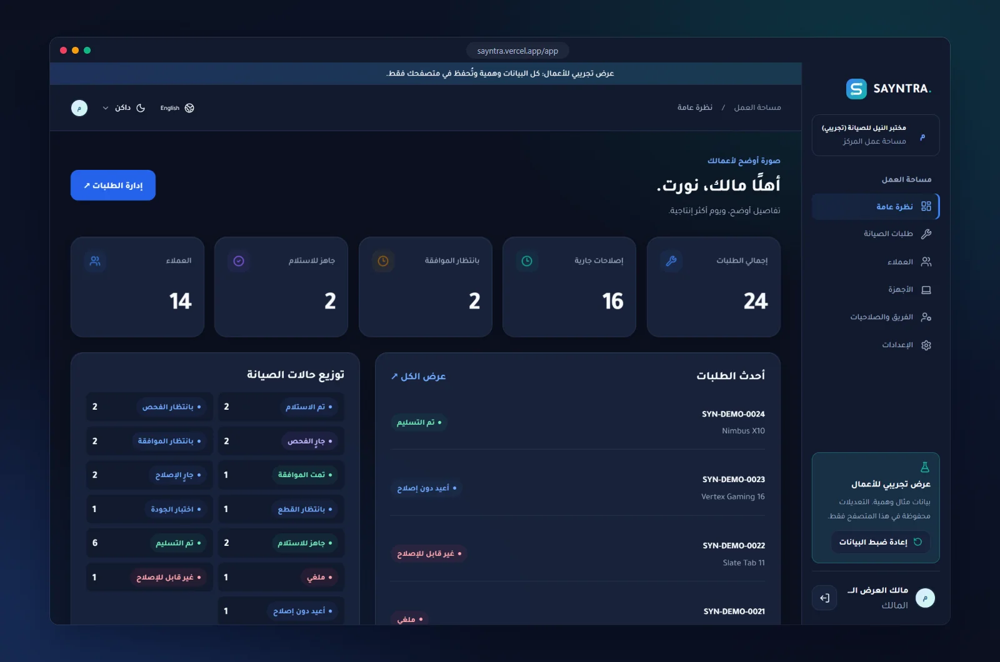<br><sub><b>العربية</b>: the full workspace mirrored right-to-left.</sub></td>
<td>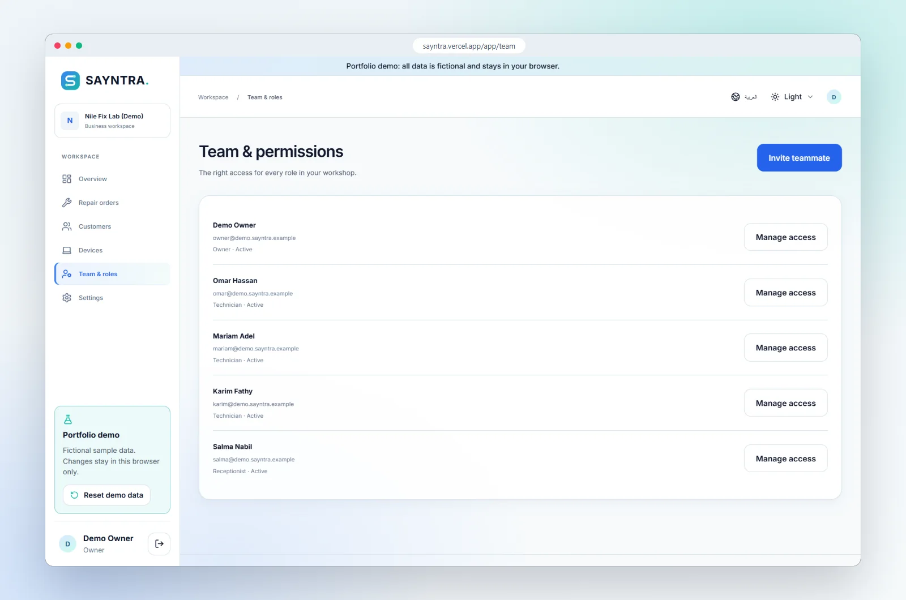<br><sub><b>Team and permissions</b>: roles, invitations and activation.</sub></td>
</tr>
<tr>
<td>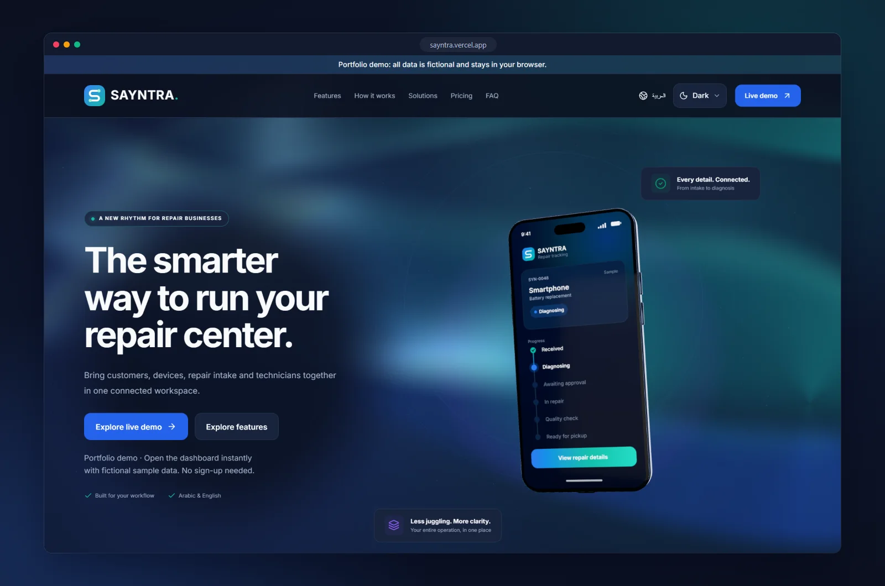<br><sub><b>Landing hero</b>: the procedural 3D device and the demo entry point.</sub></td>
<td>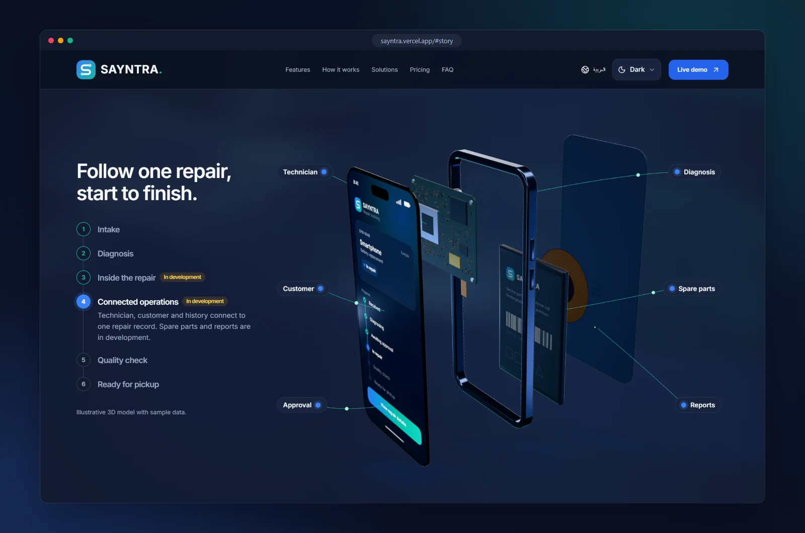<br><sub><b>Follow one repair</b>: the exploded device during the scroll story.</sub></td>
</tr>
<tr><td colspan="2">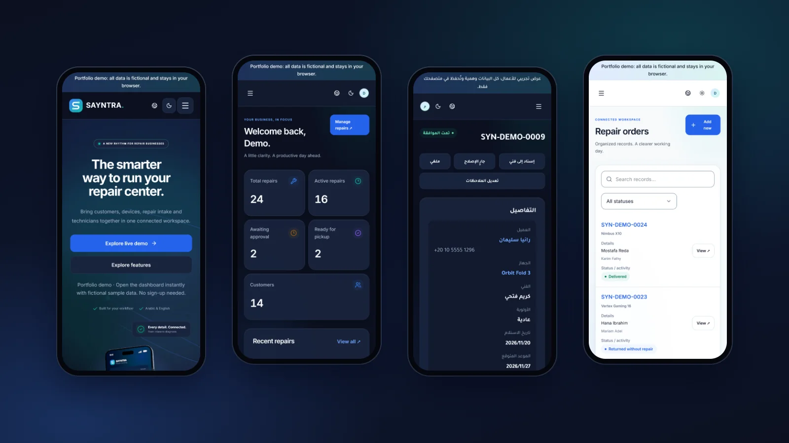<br><sub><b>On phones</b>: landing, dashboard, an Arabic repair order and the repairs list at 390 px.</sub></td></tr>
</table>

More captures: [light dashboard](docs/media/dashboard-light.webp) · [customer detail](docs/media/customer-detail.webp) · [Arabic repair](docs/media/arabic-repair.webp) · [Arabic hero](docs/media/arabic-hero.webp) · [light hero](docs/media/hero-light.webp) · [features](docs/media/features.webp).

## Architecture

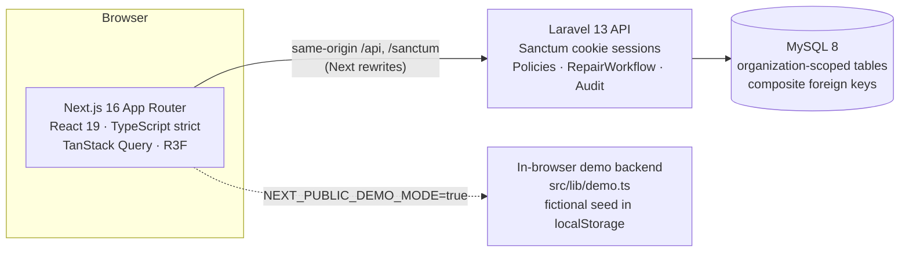

**Full application.** The browser only talks to the Next.js origin. Next rewrites `/api` and `/sanctum` to Laravel, so Sanctum's session and XSRF cookies stay first-party. Laravel resolves the active organization from the session membership; it never trusts an organization ID sent by the client.

**Portfolio demo.** `src/lib/api.ts` routes every request to `demoRequest()` when the build flag is on (or a demo session is active). The demo backend answers with the same response shapes as Laravel, enforces the same transition map and stores its state in `localStorage`. The demo build disables the API rewrites, replaces sign-in and registration pages with an explanation, and shows a permanent *Portfolio demo* banner. The Laravel code is untouched by demo mode.

| Area | Used |
|---|---|
| Frontend | Next.js 16.4.6 (App Router, webpack build), React 19, TypeScript strict, TanStack Query 5, Motion 12 |
| 3D | Three.js 0.187, React Three Fiber 9, Drei 10, custom GLSL for the ambient background |
| Styling | Tailwind 4 pipeline with hand-written CSS on logical properties; Inter and Tajawal served locally; light, dark and system themes |
| Backend | Laravel 13, PHP 8.3+, Sanctum 4 (cookie sessions, CSRF), form requests, policies, notifications |
| Data | MySQL 8, organization-scoped models with composite foreign keys, status history and activity logs |
| Quality | ESLint, `tsc --noEmit`, PHPUnit, Playwright (Chrome), GitHub Actions CI with a MySQL 8.4 service |

```text
sayntra/
├─ backend/                    Laravel 13 API
│  ├─ app/Http/Controllers/    auth, organization, customers, devices, repairs, team
│  ├─ app/Http/Middleware/     ResolveOrganization, LocaleAndHeaders
│  ├─ app/Services/            RepairWorkflow (transitions, assignment, diagnosis), Audit
│  ├─ app/Tenancy/             TenantContext (fails closed without an organization)
│  ├─ config/sayntra.php       roles and permission sets
│  ├─ database/migrations/     organization-scoped schema with composite foreign keys
│  └─ tests/Feature/           auth lifecycle, tenancy, operations
├─ frontend/                   Next.js 16
│  ├─ src/app/                 public pages, /demo and the /app workspace
│  ├─ src/features/            landing, auth, operations (dashboard, directory, team, settings)
│  ├─ src/features/three/      device model, hero, story and ambient scenes
│  ├─ src/lib/api.ts           API client; routes to the demo backend when enabled
│  ├─ src/lib/demo.ts          in-browser demo backend, fictional seed, Arabic data
│  └─ tests/e2e/               Playwright suites
├─ brand/                      original SVG logo variants
└─ docs/                       architecture, API, permissions, testing, deployment, case study
```

## Security and tenant isolation

- **Server-assigned tenancy.** Tenant models fail closed without an organization context, and ownership comes from the session membership. Customers, devices, repairs and history reference each other through composite `(organization_id, id)` foreign keys, so a row can never point into another organization.
- **Authorization.** Fixed role permissions in `config/sayntra.php`, a repair policy, and technician queries limited to their own assignments. Technician responses omit customer contact data and device serial numbers.
- **Consistent workflow.** Transitions run in database transactions with row locks and an `expected_status` check, so two people cannot move the same repair from a stale screen.
- **Accounts.** Hashed passwords, CSRF protection, session regeneration on login, login throttling, signed email verification, single-use password resets, hashed expiring invitation tokens and last-owner protection.
- **Repository hygiene.** No `.env` files, keys, dumps or logs are tracked. Only `.env.example` files with blank placeholders are committed. The demo seed uses reserved example domains and obviously fictional numbers.

Backend tests cover cross-tenant reads, writes and relationship rejection, technician privacy, disallowed and stale transitions, invitation token reuse and last-owner protection. See [PERMISSIONS.md](docs/PERMISSIONS.md) and [ARCHITECTURE.md](docs/ARCHITECTURE.md).

## Getting started

**Portfolio demo only** (Node.js 20.9+, no backend needed):

```bash
git clone https://github.com/Youssef-Elalfy/sayntra.git
cd sayntra/frontend
npm ci
# PowerShell: $env:NEXT_PUBLIC_DEMO_MODE="true"; npm run dev
NEXT_PUBLIC_DEMO_MODE=true npm run dev     # http://localhost:3000 → "Explore live demo"
```

**Full application** (PHP 8.3+, Composer, MySQL 8, Node.js 20.9+):

```bash
cd backend
composer install
cp .env.example .env            # fill DB_DATABASE, DB_USERNAME, DB_PASSWORD with your own local values
php artisan key:generate
php artisan migrate
php artisan serve               # http://127.0.0.1:8000

cd ../frontend
npm ci
npm run dev                     # http://localhost:3000, proxies /api and /sanctum to Laravel
```

Mail uses the `log` driver locally: verification, reset and invitation links are written to `backend/storage/logs/laravel.log`. Optional local demo users need a password you choose, supplied through `DEMO_SEED_PASSWORD`; none is stored in the repository. Windows steps are in [LOCAL_SETUP_WINDOWS.md](docs/LOCAL_SETUP_WINDOWS.md), and an Arabic quick start is in [START_HERE_AR.md](docs/START_HERE_AR.md).

## Testing and QA

```bash
cd frontend && npm run typecheck && npm run lint && npm run build
cd backend && php artisan test     # needs a separate *_test MySQL database
```

<details>
<summary><b>Recorded results</b> (from the project's own runs; details in <a href="docs/QUALITY.md">QUALITY.md</a>)</summary>

| Check | Result |
|---|---|
| Full Playwright suite, production build against real Laravel + MySQL, Chrome | **38 passed**, 0 failed |
| Demo and 3D suites against the live deployment (`sayntra.vercel.app`) | **9 passed** |
| Responsive story labels: 6 stages × 10 widths (320–1920 px) × English/Arabic | All labels inside the stage and viewport, no horizontal overflow |
| Text contrast, English/Arabic × light/dark, sampled over the animated background | Lowest measured ratio 5.88 : 1 |
| Hero frame rate, 1440 × 900 at DPR 1, Chrome on Intel UHD 630 | 60 fps (the requestAnimationFrame cap) |
| `npm audit` (frontend) | 0 vulnerabilities |
| `typecheck`, `lint`, `build` | Passed |
| PHPUnit (21 tests) | Runs in CI against MySQL 8.4. Locally 19 of 21 were blocked by a MySQL privilege on the test database, so no local pass is claimed. |

Not verified: Safari, Firefox, physical phones, high-DPR GPU performance, a full WCAG audit and load testing.
</details>

## Deployment

The public demo deploys to Vercel from `frontend/` with `NEXT_PUBLIC_DEMO_MODE=true` and `NEXT_PUBLIC_DEPLOY_STAGE=demo`. It needs no server credentials. Deploying the full application requires a separate Laravel host and a managed MySQL database; the plan and security checklist are in [DEPLOYMENT.md](docs/DEPLOYMENT.md). That production setup has not been deployed.

## Limitations and roadmap

Implemented today: accounts, organizations, team roles and invitations, customers, devices, repair intake, assignment, diagnosis, the guarded workflow up to *Ready for pickup*, audit history and the bilingual, themed interface.

Not yet implemented in the Laravel backend: estimates and customer approval, spare-parts inventory, invoices and payments, the protected handover that records *Delivered*, a customer tracking portal, warranties, attachments, notifications and reports. The demo simulates customer approval and delivery so the full journey can be explored; the landing story labels those stages as *In development*.

Next milestones, in order: estimates with integer minor-unit money, inventory with transactional stock movements, invoices and protected handover, then tracking, warranties, notifications and reports. See [STATUS.md](STATUS.md).

## Credits

Product design, brand, 3D device model, shaders, interface and code are original work for SAYNTRA. Typefaces: Inter and Tajawal, under the SIL Open Font License 1.1. No third-party 3D models, stock photos or AI-generated screenshots are used; every image in this README is a capture of the live deployment.

Designed and developed by **Youssef Elalfy** · [GitHub](https://github.com/Youssef-Elalfy)
