# SAYNTRA: designing a bilingual repair-management platform

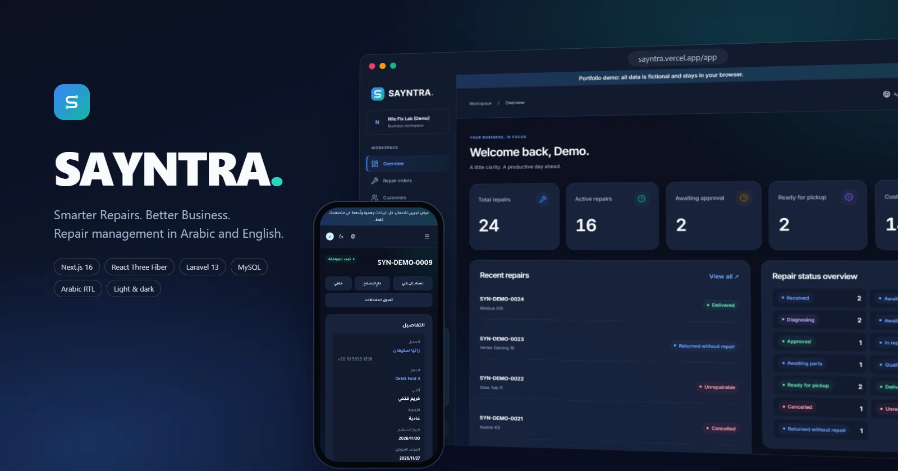

  <a href="https://sayntra.vercel.app"><b>Live website</b></a> &nbsp;·&nbsp;
  <a href="https://sayntra.vercel.app/demo"><b>Interactive demo</b></a> &nbsp;·&nbsp;
  <a href="../README.md"><b>Repository</b></a> &nbsp;·&nbsp;
  <a href="media/preview.mp4"><b>Walkthrough video</b></a>

**Role:** product design, brand, UI/UX, 3D, frontend and backend engineering
**Stack:** Next.js 16 · React 19 · TypeScript · Three.js / React Three Fiber · Laravel 13 · Sanctum · MySQL 8 · Playwright
**Type:** independent portfolio project and development checkpoint. All demo data is fictional.

---

## 01. Project overview

SAYNTRA is a repair-management workspace for phone and electronics repair centers. A receptionist registers the customer and the device, opens a repair order and assigns a technician. The technician records a diagnosis and moves the repair through an enforced sequence of statuses until it is ready for pickup. Owners see the whole operation on a dashboard. Everything works in Arabic and English, in light and dark.

The project has two faces:

- **The application:** a Next.js frontend over a Laravel 13 API and MySQL, with cookie sessions, roles and organization-scoped multi-tenancy.
- **The public demo:** the same frontend, compiled with a flag that swaps the API for an in-browser backend with a fictional repair center, *Nile Fix Lab*. Anyone can open it at [sayntra.vercel.app/demo](https://sayntra.vercel.app/demo) without an account.

The landing page introduces the product with a procedurally modelled 3D smartphone that follows one repair from intake to pickup.

## 02. Problem

Repair centers handle many small, time-sensitive jobs with several people touching each one. Without a shared record, the same questions come up every day: *Who has this phone? Has it been diagnosed? Are we waiting for the customer or for a part? Why is it still here?* Paper tickets and chat threads answer them slowly and inconsistently, and status can change without anyone knowing who changed it.

Language is a second gap. For Arabic-speaking teams, business software is often English-first, with Arabic bolted on: mirrored text inside unmirrored layouts, mixed number formats, untranslated statuses.

## 03. Objectives

1. **One record per repair** with a clear owner, a current status and a complete history.
2. **A workflow that cannot be skipped.** Statuses move only along allowed paths, and every move is attributed.
3. **Separation between businesses.** Many repair centers can share one deployment without any chance of seeing each other's data.
4. **Arabic and English as equals,** including layout direction, typography, dates and status vocabulary.
5. **A first impression that explains the product,** not a stock hero image.
6. **A demo anyone can open** without exposing a real backend, database or credentials.

**Intended users:** repair-center owners and managers, front-desk receptionists and technicians, in small and medium shops, with Egypt and the Arab region as the reference context.

## 04. My role

I designed and built SAYNTRA end to end: product scope, information architecture, brand and logo, the design system, the 3D device and its shaders, the Next.js frontend, the Laravel API and database schema, the in-browser demo backend, the test suites and the Vercel deployment.

## 05. Research and product thinking

This project did not include formal user interviews or usability testing, and none are claimed. The product decisions come from working through the repair process itself and from the constraints any real repair shop has:

- **Roles mirror the counter.** The person who takes the device is rarely the person who opens it. That split became the receptionist and technician roles, with owner and manager above them.
- **Technicians need the job, not the customer's phone number.** Technician responses omit customer contact data and device serial numbers.
- **Repeat devices are common.** Devices are first-class records, so a phone that returns keeps its history.
- **Status names must be plain.** *Awaiting diagnosis*, *Awaiting parts*, *Ready for pickup*: words both the counter and the customer understand, translated into natural Arabic rather than literal Arabic.
- **Scope honesty.** Estimates, inventory, invoices and delivery handover are real requirements, but half-built financial features are worse than absent ones. They are listed as next milestones and labelled *In development* on the landing page.

## 06. Brand identity

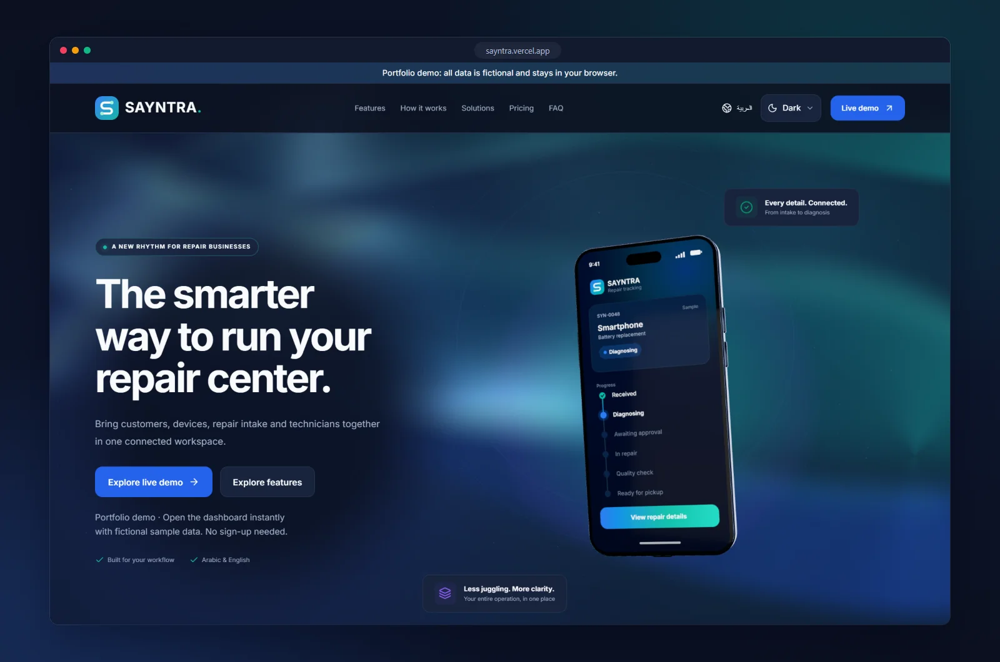

*SAYNTRA · صاينترا · Smarter Repairs. Better Business.*

The monogram is an **S** drawn as a single route between two nodes: the path a repair takes from intake to pickup. It ships as original SVG variants for light, dark and monochrome use in [`brand/`](../brand).

The palette is built on a trustworthy **blue `#3B82F6`** and an operational **teal `#14B8A6`**, with **mint `#2DD4BF`** for completion and **violet `#8B5CF6`** as a secondary accent. Neutrals run from cool light greys to a deep navy for dark mode. Inter carries English and Tajawal carries Arabic; both are served locally.

## 07. UI/UX design system

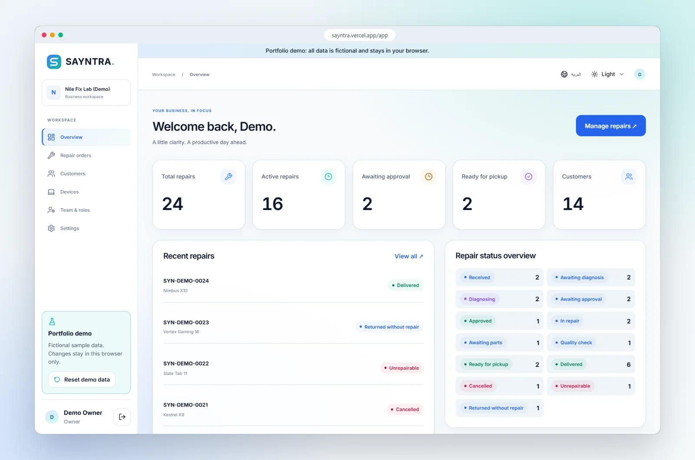

The workspace uses a small, consistent set of parts: a sidebar with the organization and role-aware navigation, a top bar with breadcrumbs, language and theme, KPI cards, data tables, status badges, forms, confirmation dialogs and a timeline.

- **Tokens first.** Color, surface, border, radius and shadow are CSS custom properties with light and dark values. A *System* theme follows the operating system live.
- **Status color is semantic.** Each status has a fixed hue used in badges, the overview and the timeline, so color reinforces the label but never replaces it.
- **Logical properties throughout.** `margin-inline`, `padding-inline-start` and `inset-inline` mean one stylesheet serves both directions.
- **Depth without noise.** Cards use a subtle pointer tilt and glare on desktop mice only. It is off for touch and for reduced motion.
- **Accessible defaults.** Labelled controls, native dialogs, a keyboard-operable theme menu (arrows, Home, End, Enter, Escape, focus return) and visible focus states. A contrast check across English/Arabic and light/dark measured a lowest text ratio of 5.88 : 1.

## 08. Immersive landing experience

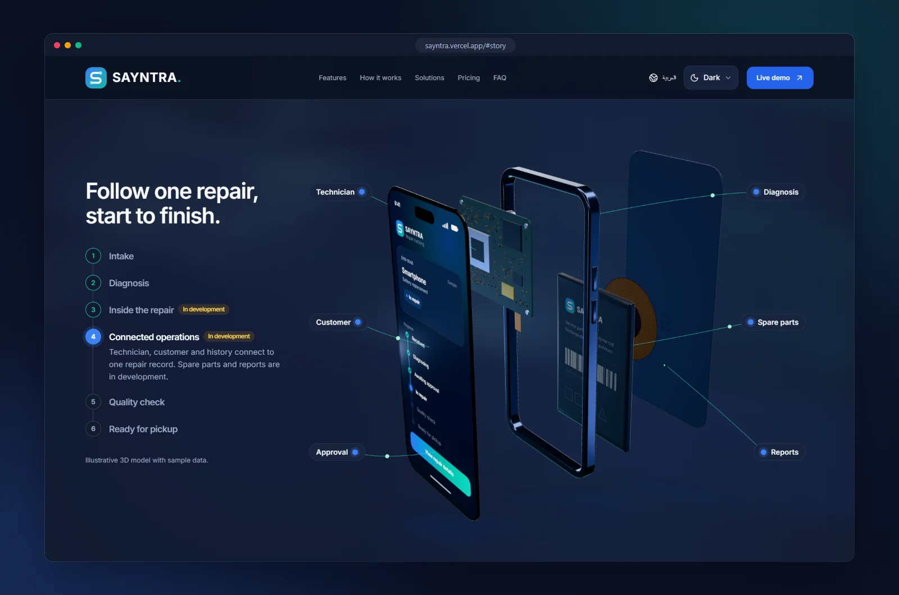

The landing page had to explain *repair management* in seconds. Instead of a screenshot, it uses one original smartphone, modelled in code with no downloaded assets: a titanium frame with real bevels, clear-coated glass, a frosted back with the monogram, iridescent lenses and, inside, a logic board, battery, flex cable and charging coil.

- **Hero.** The device settles into pose, floats gently and follows the pointer. Its screen is a live canvas texture showing a SAYNTRA repair card in the current language, laid out right-to-left in Arabic. The whole composition mirrors in RTL.
- **Follow one repair.** A sticky, scroll-driven story: intake → diagnosis (the back glass turns translucent and a scan band sweeps the battery) → exploded view → connected operations (technician, diagnosis, customer, parts, approval, reports) → reassembly → ready for pickup.
- **Living Network.** A fixed background of two shader-lit silk ribbons over a sparse circuit network with pulses travelling along PCB-style traces. It reacts to pointer, scroll and theme.

Labels in the story are real DOM, laid out by CSS. A `ResizeObserver` measures each label's anchor dot, and the 3D connection lines end exactly there. The device is scaled into the free space between the label columns every frame. That keeps the composition correct in both directions and at every width.

Fallbacks are part of the design: the 3D scenes load lazily, pause off-screen and choose a render tier by device capability. With reduced motion they render on demand. Without WebGL, the hero shows a 2D interface preview and the story becomes a static list.

## 09. Dashboard experience

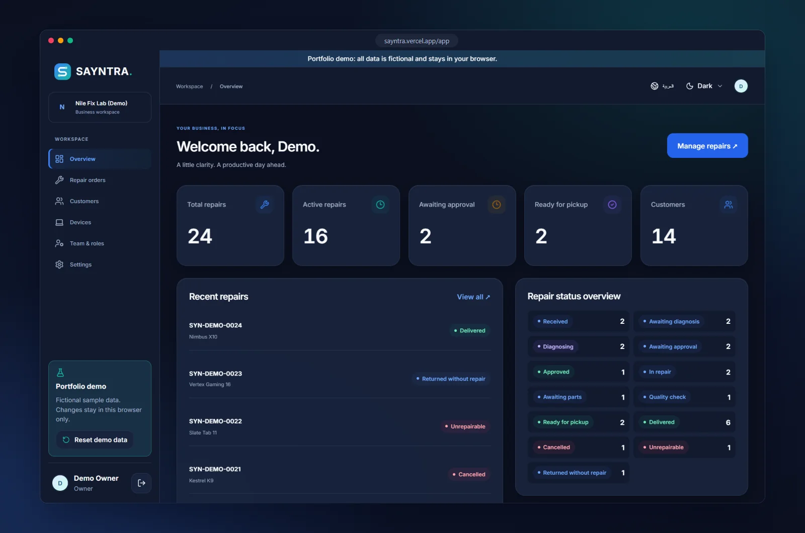

The dashboard answers *how is today going?* in one view: total repairs, active repairs, repairs awaiting approval, devices ready for pickup and customers. Below are the most recent repairs and a full status overview. All figures come from stored records and are filtered by role, so a technician sees counts for their own assignments only. The KPI numbers count up once on load and stay static after that.

## 10. Repair management workflow

<table>
<tr>
<td width="50%">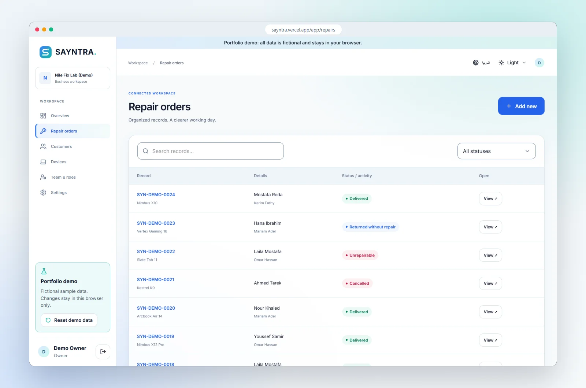</td>
<td width="50%">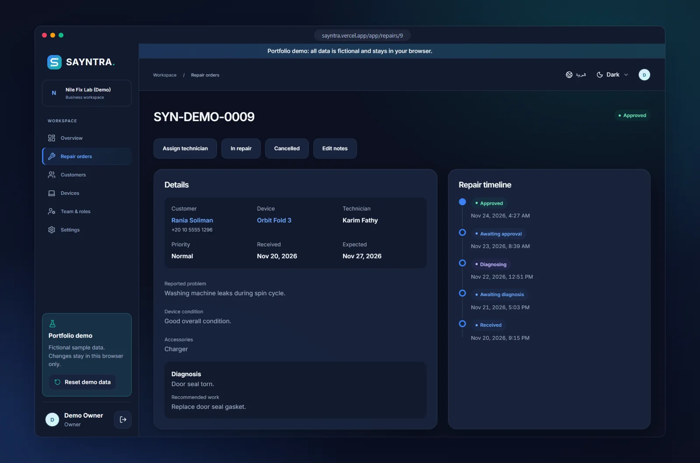</td>
</tr>
</table>

Each repair order links a customer and a device and receives a unique reference. The detail page shows only the **next allowed steps** as buttons. Every step asks for confirmation and is recorded in the timeline with the actor and time.

In Laravel, `RepairWorkflow` owns the rules:

- A transition map defines every legal move: `received → awaiting_diagnosis → diagnosing → …`, with `cancelled` and `unrepairable` exits.
- Diagnosis requires an assigned technician. Quality check requires notes. Closed repairs cannot be reassigned.
- Each change runs in a transaction with a row lock and an **expected status**. If someone else moved the repair first, the request is rejected instead of silently overwriting their change.

The list supports search by repair reference and filtering by status and priority. On narrow screens the table becomes a stack of cards.

## 11. Customer and device management

<table>
<tr>
<td width="50%">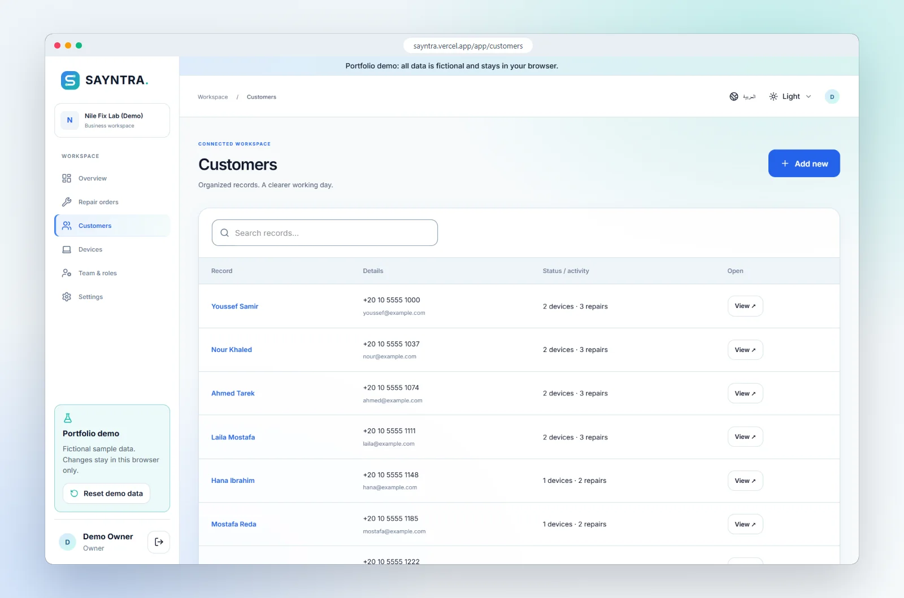</td>
<td width="50%">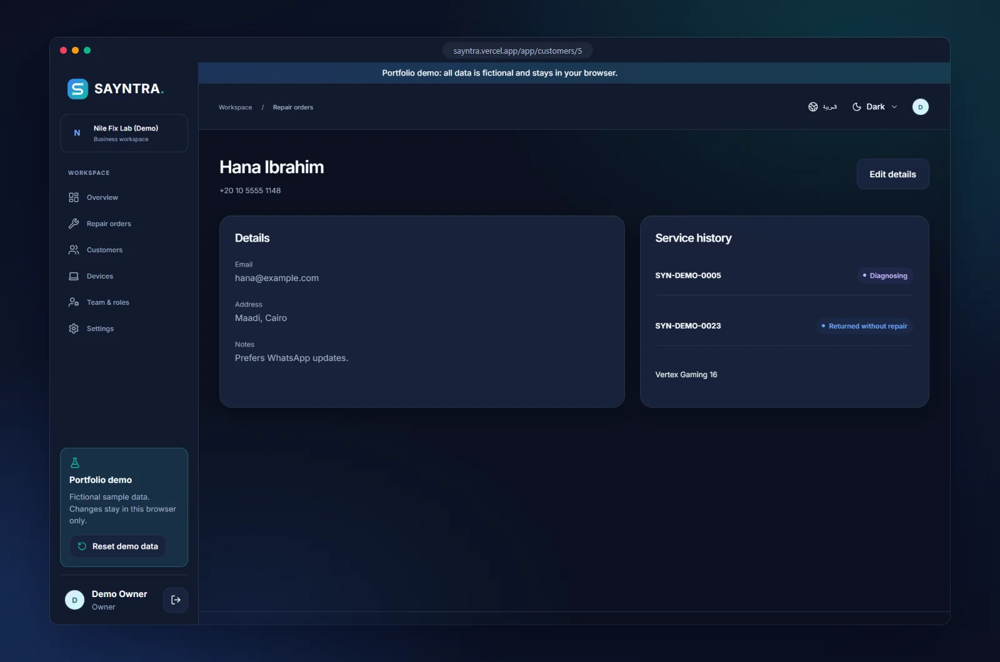</td>
</tr>
</table>

Customers are searchable and keep their full repair history. Phone numbers are normalized before storage and are unique within an organization, which prevents the most common duplicate. Devices belong to a customer, carry brand, model and identifiers, and keep their history across repeat repairs. Customer archival exists in the API and is refused while the customer has active repairs.

## 12. Authentication and architecture

The real application uses **Laravel Sanctum cookie sessions**, not tokens in browser storage. The browser talks only to the Next.js origin. Next rewrites `/api` and `/sanctum` to Laravel, so session and XSRF cookies are first-party and no credentialed cross-origin requests are needed.

Account flows include registration (which creates the organization and its owner in one transaction), login and logout with session regeneration, login throttling, signed email verification, password reset and team invitations with hashed, expiring, single-use tokens.

**The demo is deliberately separate.** In the demo build (`NEXT_PUBLIC_DEMO_MODE=true`):

- `src/lib/api.ts` sends every request to `demoRequest()` in `src/lib/demo.ts`, which returns the same response shapes as Laravel and enforces the same transition map.
- The API rewrites are disabled, so the public site cannot reach any backend.
- Sign-in, registration, verification and password pages are replaced with a short explanation and a link to the demo.
- A permanent banner states that the data is fictional and stays in the visitor's browser. *Reset demo data* restores the seed.

None of this changes the Laravel code or its authentication.

## 13. Multi-tenant architecture

Many repair centers share one database, so isolation has to hold at several layers:

1. **Context from the session.** Middleware resolves the active organization from the user's membership. A submitted organization ID is never trusted.
2. **Models fail closed.** Tenant models refuse to query without an organization context.
3. **The database enforces it.** Customers, devices, repairs and history reference each other through composite `(organization_id, id)` foreign keys. Even a bug in application code cannot attach a device to another organization's customer.
4. **Roles narrow it further.** Permission sets per role, a repair policy and technician queries limited to assigned repairs.

Feature tests cover cross-tenant reads, writes and relationship attempts, technician privacy, invitation token reuse and last-owner protection.

## 14. Arabic and English experience

<table>
<tr>
<td width="50%">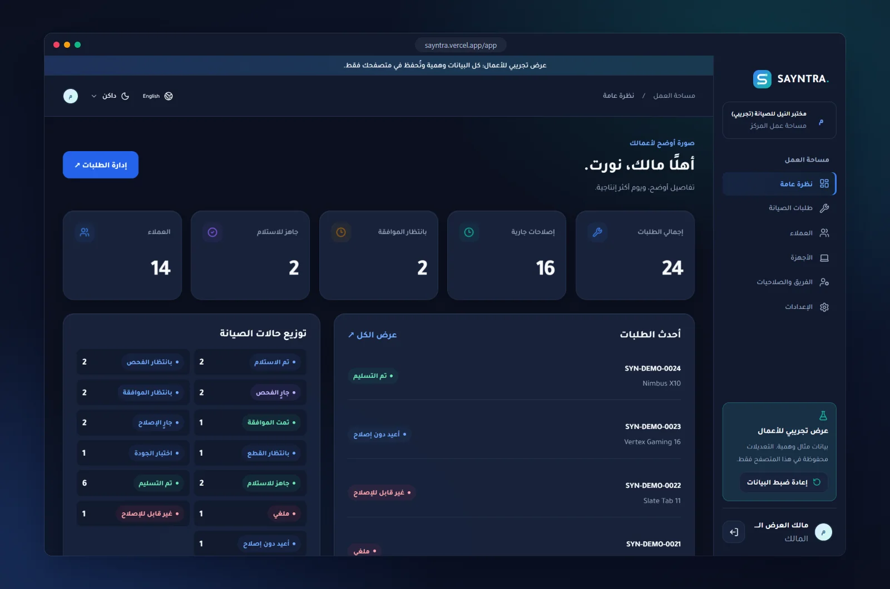</td>
<td width="50%">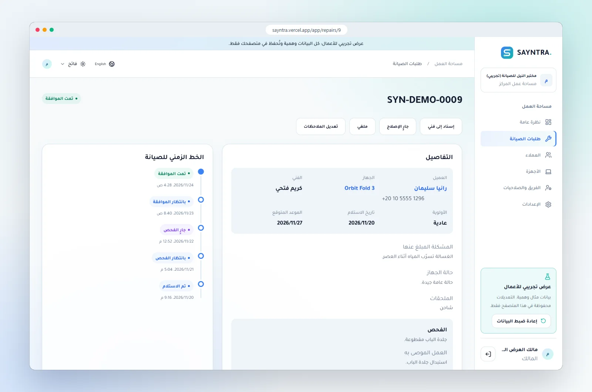</td>
</tr>
</table>

Arabic is not a translation layer on top of an English layout:

- `lang` and `dir` are set on the document, and the whole interface (sidebar, breadcrumbs, tables, timeline, dialogs) mirrors through logical CSS properties.
- Tajawal is used for Arabic text with its own weights, and Inter for English.
- Statuses, roles, empty states and validation messages have natural Arabic wording. The demo seed has its own Arabic names and notes.
- The 3D hero mirrors its composition, and the phone's screen texture is drawn right-to-left in Arabic.
- The language choice persists in a cookie, so server-rendered pages arrive in the right direction without a flash.

## 15. Responsive design

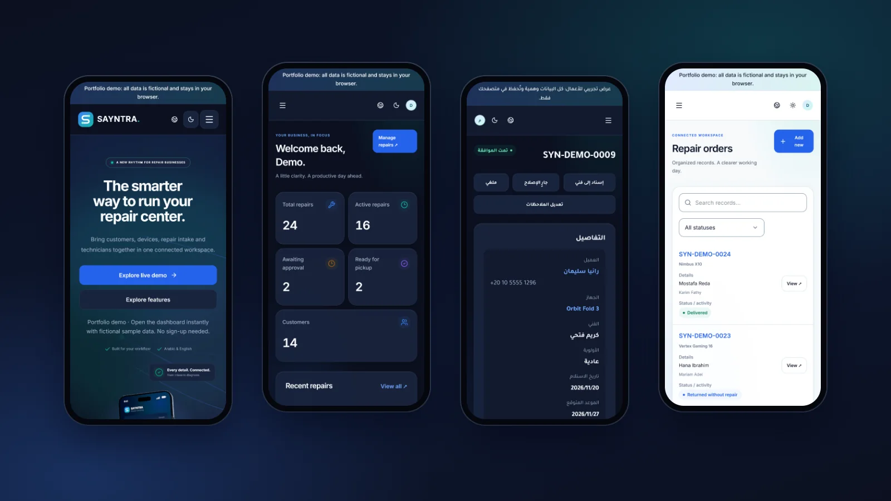

The workspace collapses its sidebar into a menu, turns data tables into cards and lets repair actions wrap. The landing hero and story recompose for narrow screens, and the ambient WebGL background is switched off on small or touch devices.

Responsiveness was checked by measurement, not by eye alone: an audit script loaded 14 pages at 10 widths in English-light and Arabic-dark, looking for page-level horizontal overflow. It found and fixed an overflow on `/login` at 320 px and in the data tables. A Playwright suite checks every story stage at 10 widths from 320 to 1920 px in both languages.

## 16. Engineering challenges

- **One frontend, two backends.** The demo had to behave like the real API without forking the interface. Matching response shapes and the transition map in `demo.ts`, and switching at the API client, kept every screen shared. Laravel did not change.
- **3D labels that never collide.** Positioning labels from 3D coordinates broke at some widths and in RTL. Moving the labels into CSS layout and making the 3D lines follow measured DOM anchors fixed both at once.
- **Arabic in a WebGL texture.** The device screen is drawn to a canvas, where CSS direction does not apply. The right-to-left layout is drawn explicitly: mirrored coordinates, swapped text alignment and an Arabic-first font stack.
- **A stacking-context bug.** An `isolation: isolate` rule on the workspace shell let the demo banner cover the sidebar. Removing the isolation and giving the sidebar an explicit layer fixed it.
- **Contrast over moving backgrounds.** Text over an animated gradient can pass in one frame and fail in another. Contrast was sampled across three animation frames for each language and theme.
- **A framework security stop.** A Next.js release refused to build with a security error. Upgrading to the patched 16.4.6 resolved it, and a non-breaking `npm audit fix` cleared the remaining development-only advisories.

## 17. Performance, QA and testing

All results below come from runs on this project. Nothing here is estimated.

| Check | Result |
|---|---|
| Full Playwright suite: production build, real Laravel API and MySQL, Chrome | **38 passed**, 0 failed |
| Demo and 3D suites against the live Vercel deployment | **9 passed** |
| Story labels: 6 stages × 10 widths × English/Arabic | Inside the stage and viewport, no overflow |
| Text contrast, 32 samples across languages, themes and animation frames | Lowest ratio 5.88 : 1 |
| Hero frame rate, 1440 × 900, DPR 1, Chrome on an Intel UHD 630 | 60 fps (requestAnimationFrame cap) |
| Frontend `typecheck`, `lint`, `build` | Passed |
| `npm audit` (frontend) | 0 vulnerabilities |
| PHPUnit, 21 tests | Configured to run in CI on MySQL 8.4. Locally, 19 were blocked by a MySQL privilege on the test database, so no local pass is claimed. |

The demo tests also assert that browsing the public demo makes **no** request to `/api` or `/sanctum`, and that the console stays free of errors.

**Not verified:** Safari, Firefox, physical phones, high-DPR GPU performance, a full WCAG audit, load testing and penetration testing.

## 18. Outcome and next steps

SAYNTRA is a working foundation: multi-tenant accounts and teams, customers and devices, repair intake, assignment, diagnosis and a guarded workflow up to *Ready for pickup*, with an audit trail. It is fully bilingual and themed, and it has a landing experience that explains the product through a 3D device. The public demo lets anyone try the workspace safely in a few seconds.

It is not a commercial product, and it has no customers or revenue to report.

**Next milestones:**

1. Estimates and customer approval, with money stored as integer minor units.
2. Spare-parts inventory with transactional stock movements.
3. Invoices, payments and a protected handover that records *Delivered*.
4. A customer tracking page, warranties, attachments and notifications.
5. A first production deployment of the Laravel API, then Safari, Firefox and physical-device QA.

---

SAYNTRA is an independent portfolio project. All demo data is fictional. Design, brand, 3D model, shaders and code are original. Typefaces are used under the SIL Open Font License 1.1.
